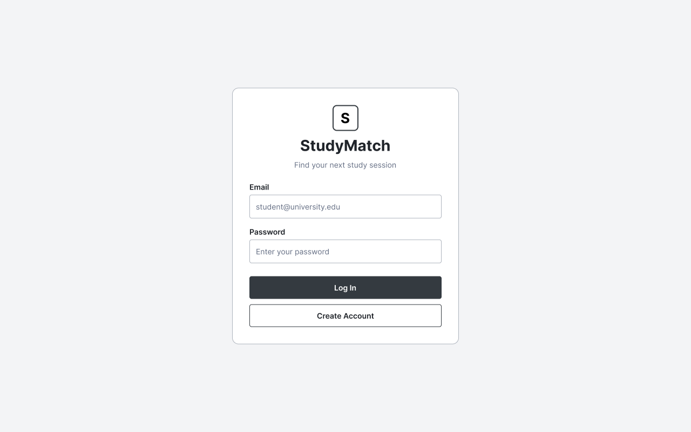
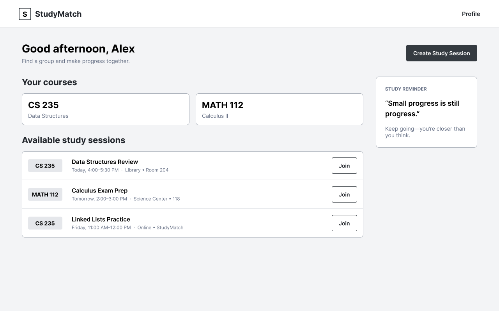
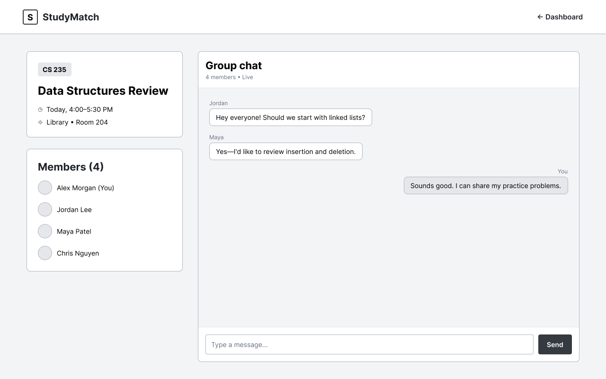

# StudyMatch

[My Notes](notes.md)

StudyMatch is a web application that helps students find other students who are taking the same course or want to study together.

> [!NOTE]
> This is a template for your startup application. You must modify this `README.md` file for each phase of your development. You only need to fill in the section for each deliverable when that deliverable is submitted in Canvas. Without completing the section for a deliverable, the TA will not know what to look for when grading your submission. Feel free to add additional information to each deliverable description, but make sure you at least have the list of rubric items and a description of what you did for each item.

> [!NOTE]
> If you are not familiar with Markdown then you should review the [documentation](https://docs.github.com/en/get-started/writing-on-github/getting-started-with-writing-and-formatting-on-github/basic-writing-and-formatting-syntax) before continuing.

### Elevator pitch

Finding people to study with shouldn't be harder than studying itself. StudyMatch helps students connect with classmates that are studying the same subjects. Through StudyMatch, students can create sessions, find sessions for any courses they are struggling with, and communicate with their study groups to have accountability that helps them stay focused on their academic goals. Whether preparing for exams or going through difficult homework, StudyMatch will provide a service that makes finding a study buddy easier.

### Design

The following images show the main pages planned for StudyMatch.

#### Login Page

Users can log in to their StudyMatch account or create a new account.

#### Dashboard

The dashboard shows available study sessions and lets users create or join sessions.

#### Study Session

The study session shows the course information, members, and a chat box where members can communicate in real-time.

### Key features

- Users can create an account and log in.
- Users can add the courses they are currently taking.
- Users can open study sessions for specific courses.
- Users can browse study sessions they are looking for.
- Users can join available study sessions.
- Users can communicate with other users of their study group.
- Users can see live updates when students create and join study sessions.

### Technologies

I am going to use the required technologies in the following ways.

- **HTML** - I will use HTML to build a structure of the website, such as the login page, study sessions, and chats.
- **CSS** - I will use CSS to make my web application look more stylish and easy to understand how to use 
- **React** - I will use React to build reusable components for login, course lists, study sessions, and study groups. React will also handle page routing and update UI when users interact with the application.
- **Service** - I will use a Node.js/Express backend service for handling users' accounts, logging in/out, creating/joining study sessions. Also I will call a third-party API to show motivational quotes.
- **DB/Login** - I will store user accounts, courses, study sessions, and study group information in a database. Users will be able to safely register and log in/out.
- **WebSocket** - I will use WebSocket to send and receive real-time updates when users create or join sessions and to support communication between members of a study group.

Third-party API: https://api.quotable.io/random

## 🚀 Specification Deliverable

> [!NOTE]
> Fill in this sections as the submission artifact for this deliverable. You can refer to this [example](https://github.com/webprogramming260/startup-example/blob/main/README.md) for inspiration.

For this deliverable I did the following. I checked the box `[x]` and added a description for things I completed.

- [x] I completed the prerequisites for this deliverable (Git commit requirement)
- [x] Proper use of Markdown
- [x] A concise and compelling elevator pitch
- [x] Description of key features
- [x] Description of how you will use each technology including your 3rd party API and use of WebSocket
- [x] One or more rough sketches of your application. Images must be embedded in this file using Markdown image references.

## 🚀 AWS deliverable

For this deliverable I did the following. I checked the box `[x]` and added a description for things I completed.

- [x] **Rented EC2 server** - I created and configured an AWS EC2 server.
- [x] **Leased domain name** - I leased kyungju.click and configured it using AWS Route 53.
- [x] **Server accessible** from my domain: [https://startup.kyungju.click] - My startup server is accessible through my domain using HTTPS.

## 🚀 HTML deliverable

For this deliverable I did the following. I checked the box `[x]` and added a description for things I completed.

- [x] I completed the prerequisites for this deliverable (Simon deployed, GitHub link, Git commits)
- [x] **HTML pages** - I created four pages for StudyMatch: `index.html`, `dashboard.html`, `sessions.html`, and `chat.html`.
- [x] **Proper HTML element usage** - I used HTML elements including header, nav, main, footer, section, form, input, select, option, table, and button.
- [x] **Links** - I added navigation links between the Home, Dashboard, Sessions, and Chat pages.
- [x] **Text** - I added text describing StudyMatch, courses, study sessions, and study group chats.
- [x] **3rd party API placeholder** - I added a placeholder on the dashboard for motivational quotes that will eventually come from a third-party API.
- [x] **Images** - I added a StudyMatch image to the home page.
- [x] **Login placeholder** - I added email and password inputs, login and account creation buttons, and a username display placeholder.
- [x] **DB data placeholder** - I added example study session data that will eventually be stored and retrieved from the database.
- [x] **WebSocket placeholder** - I added a study group chat with example realtime messages and online users.

## 🚀 CSS deliverable

For this deliverable I did the following. I checked the box `[x]` and added a description for things I completed.

- [x] I completed the prerequisites for this deliverable (Simon deployed, GitHub link, Git commits)
- [x] **Visually appealing colors and layout. No overflowing elements.** - Styled all StudyMatch pages and fixed table overflow on smaller screens.
- [x] **Use of a CSS framework** - Used Bootstrap for buttons and UI styling.
- [x] **All visual elements styled using CSS** - Added shared styling for the login, dashboard, sessions, and chat pages.
- [x] **Responsive to window resizing using flexbox and/or grid display** - Used Flexbox and media queries to make the layout responsive.
- [x] **Use of a imported font** - Imported and used the Inter font from Google Fonts.
- [x] **Use of different types of selectors including element, class, ID, and pseudo selectors** - Used element, class, ID, and `:hover` selectors.

## 🚀 React part 1: Routing deliverable

For this deliverable I did the following.

- [x] I completed the prerequisites (Simon React deployed, GitHub link, Git commits).
- [x] **Bundled using Vite** - I converted StudyMatch into a React application using Vite, built it, and deployed it to AWS.
- [x] **Components** - I created Login, Dashboard, Sessions, and Chat React components while preserving my original CSS and Bootstrap styling.
- [x] **Router** - I implemented React Router to navigate between all four pages without full page reloads.

### Links
- [StudyMatch](https://startup.kyungju.click)
- [Simon React](https://simon.kyungju.click)
- [GitHub](https://github.com/moda0528/startup)

## 🚀 React part 2: Reactivity deliverable

For this deliverable I implemented interactive frontend behavior using React state, effects, and mocked services.

- [x] I completed the prerequisites for this deliverable (Simon React deployed, GitHub link, README and Git commits).
- [x] **All functionality implemented or mocked out** - Users can create demo accounts, log in and log out; add and remove courses; filter, create, join, leave, and delete study sessions; and send messages in their joined study-group chats. Created sessions and messages persist in the browser's `localStorage`. Dashboard motivational quotes rotate from a mock API response list. Incoming chat replies are simulated with a timer as a WebSocket placeholder.
- [x] **Hooks** - `useState` updates login forms, course filters, session creation, chat messages, quote rotation, and application data. `useEffect` saves browser data, dismisses status notifications, rotates quotes, and simulates chat replies; effects clean up their timers when components unmount. State and callback props connect the components.

### Reactivity notes

The application uses **demo-only authentication**: passwords are not saved or verified. User data, sessions, and chat messages exist only in the current browser, not in a shared backend. This functionality will be replaced during the Service, Database, and WebSocket deliverables.

- [Live StudyMatch](https://startup.kyungju.click)
- [GitHub repository](https://github.com/moda0528/startup)

## 🚀 Service deliverable

For this deliverable, I replaced the React-only demo data with an Express HTTP service. These items describe the implemented code; I will verify the production deployment separately.

- [ ] **Prerequisites** - Verify Simon **Service** is deployed at [simon.kyungju.click](https://simon.kyungju.click), the GitHub link is on StudyMatch's home page, and the repository has enough genuine Git commits.
- [x] **Node.js/Express HTTP service** - Added `service/index.js` and a separate `service/package.json`. The backend listens on port 4000 by default and accepts a command-line port argument.
- [x] **Static middleware for frontend** - Express serves the production Vite build using `express.static('public')` and returns `index.html` for React Router URLs.
- [x] **Calls to third-party endpoints** - The Dashboard uses browser `fetch` to request a real motivational quote from the DummyJSON `/quotes/random` API, with error handling and a New Quote button.
- [x] **Backend service endpoints** - Added JSON endpoints for authentication, courses, study sessions, membership, and group chat messages. The server also exposes `/api/health`.
- [x] **Frontend calls service endpoints** - React uses `fetch('/api/...')` to retrieve and change data through Express. `vite.config.js` proxies `/api` to `localhost:4000` during local development.
- [x] **Registration, login, logout, restricted endpoint** - Users can register and log in with a password; Express issues an HTTP-only authentication cookie, verifies it for protected endpoints, and invalidates it on logout. For example, `/api/auth/me`, `/api/courses`, and session-chat endpoints require login.
- [x] **BCrypt hashing** - The backend calls `bcrypt.hash(password, 10)` when creating an account and `bcrypt.compare` at login; plaintext passwords aren't saved as account records.

### Testing and limitations

- Use `cd service && npm install && npm test` to run endpoint tests, and `npm run build` in the repository root to build React.
- For local development, run `node service/index.js` in one terminal and `npm run dev` in another.
- The app currently stores accounts, sessions, and messages **in server memory**, as in the course's Simon Service example. Restarting the backend resets these records. MongoDB storage will be a later deliverable.
- The live quote depends on the external API being reachable. Chat updates are fetched periodically; real WebSocket delivery is a later deliverable.
- To deploy both applications and the backend, use the new `deployService.sh` instead of the previous React-only deployment script. Test all endpoints on the deployed site after deployment.

[StudyMatch](https://startup.kyungju.click) | [GitHub repository](https://github.com/moda0528/startup)

## 🚀 DB deliverable

For this deliverable I did the following. I checked the box `[x]` and added a description for things I completed.

- [ ] I completed the prerequisites for this deliverable (Simon deployed, GitHub link, Git commits)
- [ ] **Stores data in MongoDB** - I did not complete this part of the deliverable.
- [ ] **Stores credentials in MongoDB** - I did not complete this part of the deliverable.

## 🚀 WebSocket deliverable

For this deliverable I did the following. I checked the box `[x]` and added a description for things I completed.

- [ ] I completed the prerequisites for this deliverable (Simon deployed, GitHub link, Git commits)
- [ ] **Backend listens for WebSocket connection** - I did not complete this part of the deliverable.
- [ ] **Frontend makes WebSocket connection** - I did not complete this part of the deliverable.
- [ ] **Data sent over WebSocket connection** - I did not complete this part of the deliverable.
- [ ] **WebSocket data displayed** - I did not complete this part of the deliverable.
- [ ] **Application is fully functional** - I did not complete this part of the deliverable.
